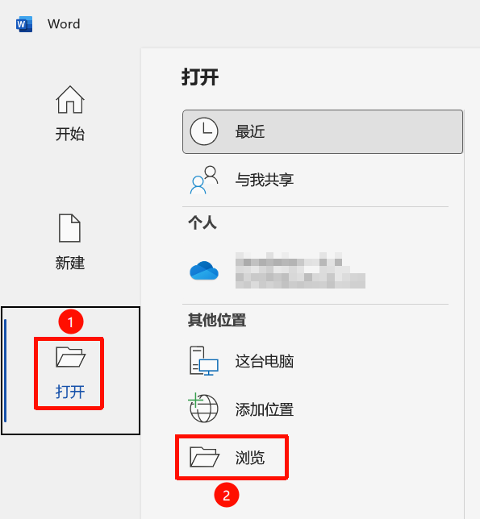
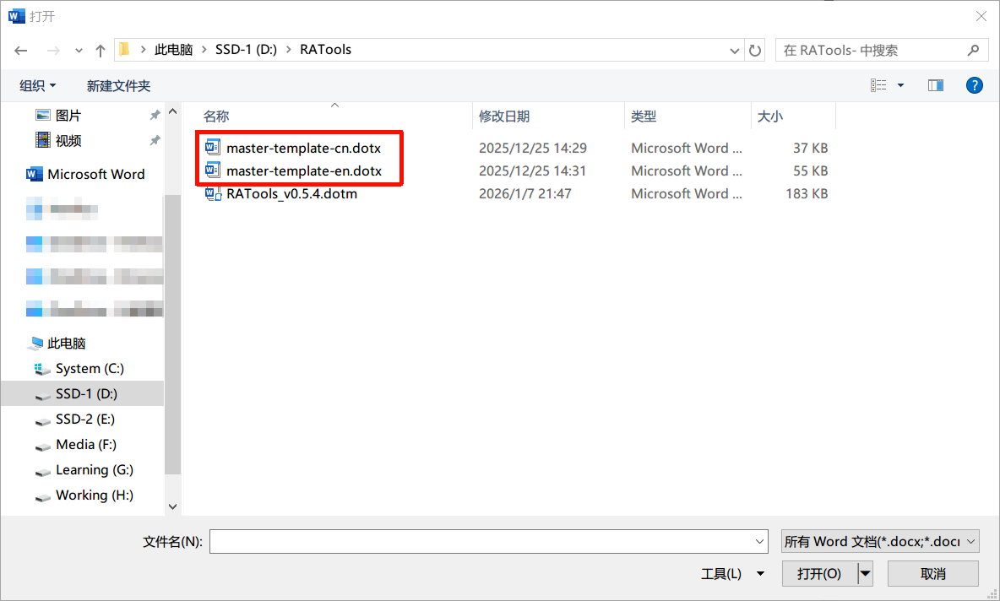
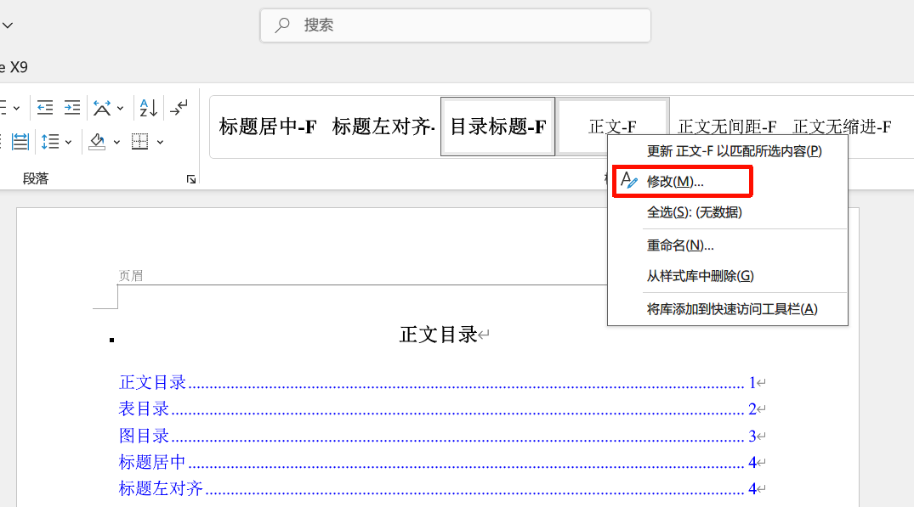

# 自定义模板与扩展宏

<a id="custom-templates"></a>
## 修改自己的样式模板

适合希望统一为单位指定字体、字号、段落间距或标题编号的用户。

1. 先备份 `master-template-cn.dotx` 或 `master-template-en.dotx`。
2. 使用 Word 的 **文件 → 打开**打开模板本身，或在资源管理器中用右键“打开”。不要误把基于模板新建的普通文档当成模板文件。
3. 打开样式窗格，找到需要调整的 `-F` 样式，右键选择修改。
4. 设置字体、字号、缩进、段前段后间距等；需要标题编号时一并检查对应列表定义。
5. 保留原有样式名称，保存并关闭模板。
6. 打开练习文档，重新[加载模板](templates.md)，应用样式并检查结果。





这些截图来自旧版教程，实际窗口可能随 Word 版本变化。不要直接覆盖唯一的原始模板；插件更新时也应保留你自己的模板副本。

### 命名和使用范围

功能区按钮依赖约定的样式名。只改变外观通常无需修改插件；随意改名可能导致按钮提示找不到样式。中文按钮与英文模板的名称有映射关系，例如“正文无缩进-F”对应 `Body Text-F`。

模板修改不会自动回写已存在的所有文档。对旧文档重新导入后，需要检查同名样式带来的排版变化；新模板中没有匹配规则的普通自定义样式，也不会全部自动导入。

<a id="custom-macros"></a>
## 把自定义宏加入宏列表

此部分面向已经具备 VBA 开发能力的维护者。普通用户无需执行。

### 推荐：从源码构建

1. 在仓库 `modules/` 中添加标准模块，编写一个**无参数的 `Public Sub`**，例如 `MyMacro`。
2. 在 `modules/UI_MacroRegistry.bas` 的 `GetMyMacroRegistry` 注册区添加：

```vba
items.Add Array("MyMacro", _
                "我的工具", _
                "说明适用场景、操作范围和结果")
```

3. 按[源码编码契约](https://github.com/PharmaRA/RATools-for-Word/blob/main/docs/vba-source-encoding.md)保存 VBA 文件。当前项目使用 GBK/936 和 CRLF，不要用默认 UTF-8 重写含中文源码。
4. 在安装了桌面 Word 的 Windows 环境中，按[构建指南](https://github.com/PharmaRA/RATools-for-Word/blob/main/docs/local-dotm-build-testing.md)配置“信任对 VBA 项目对象模型的访问”，然后在仓库根目录运行：

```powershell
powershell -ExecutionPolicy Bypass -File scripts\Build-RAToolsDotm.ps1
```

5. 使用生成的 `dist/RATools_local.dotm` 在练习文档中验证入口和行为，再部署到自己的插件目录。构建也会同步 `dotm/`，不是单纯复制一个文件。

宏列表按过程名调用宏。如果目标过程是带 `control As IRibbonControl` 参数的 Ribbon 回调，先编写无参数包装过程，再注册包装过程名。过程必须在标准模块中，不能只写在窗体按钮事件里。

### 直接在 Word VBA 编辑器中修改

1. 备份插件，把待修改的 `.dotm` 复制到启动目录以外的位置，避免直接修改正在加载的文件。
2. 在 Word 中打开该模板本身，按 `Alt+F11` 打开 VBA 编辑器。
3. 插入标准模块，编写宏，再在 `UI_MacroRegistry` 中添加注册项。
4. 编译并用无敏感内容的练习文档验证，保存模板。
5. 关闭 Word，将旧插件移到备份位置，放入修改后的插件，重新启动 Word 验证。

采用这种方式后，仓库导出的源码不一定同步变化。参与项目开发时，应按既有构建流程维护源码与实际 `.dotm` 的一致性。

## 文档维护者

用户手册使用 Markdown 编写。网站的本地构建、功能覆盖检查和发布操作见[文档站维护指南](https://github.com/PharmaRA/RATools-for-Word/blob/main/docs/docs-site.md)。
