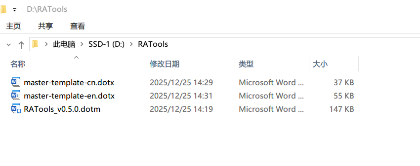
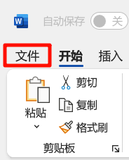
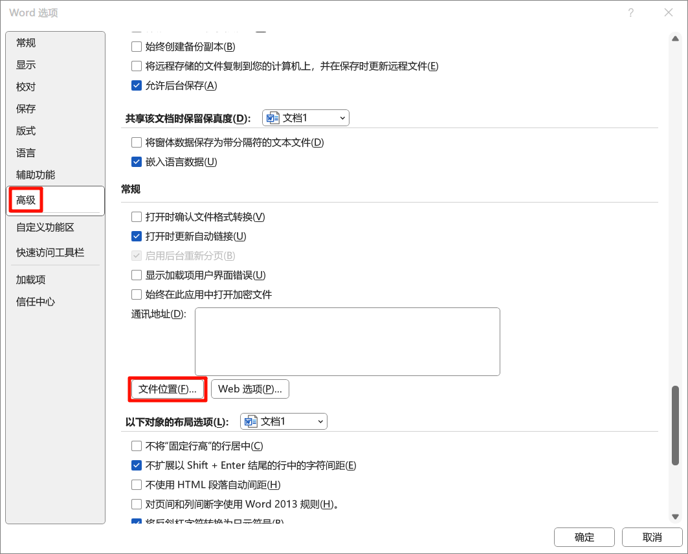
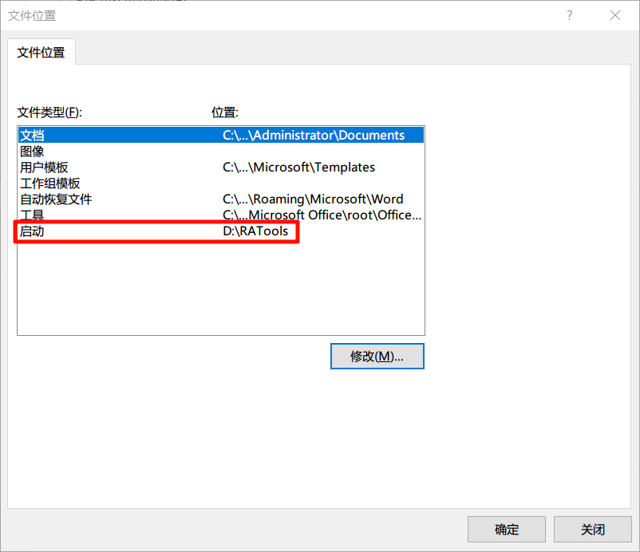
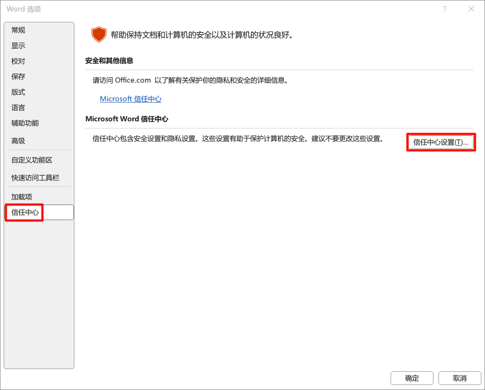
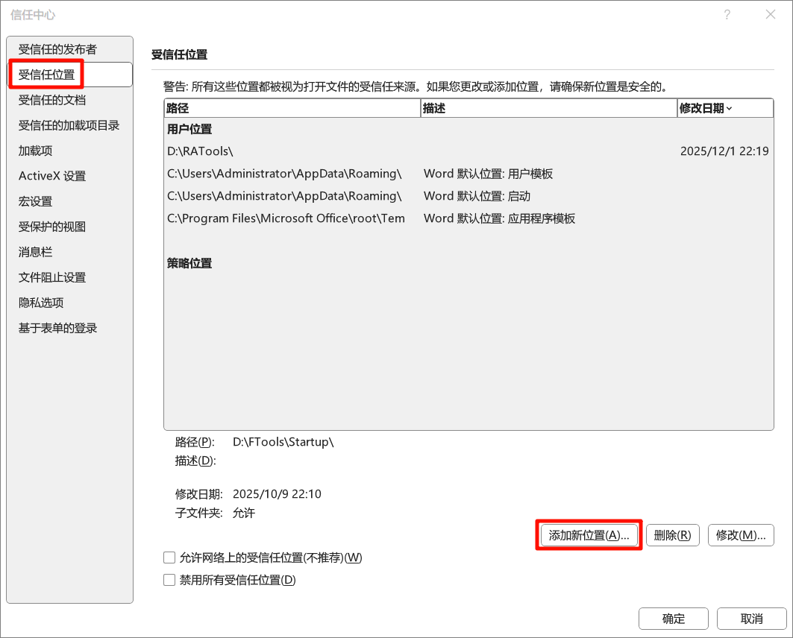
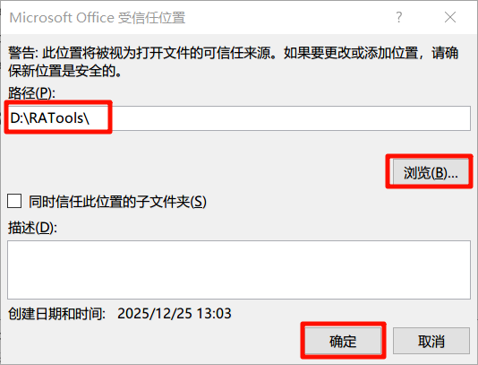
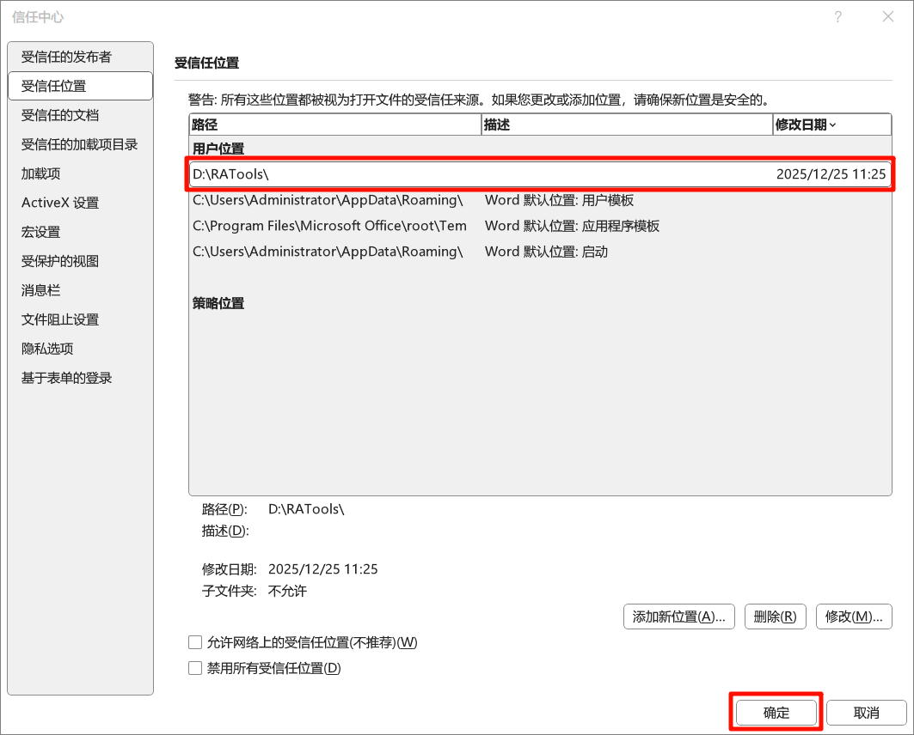

# 安装、更新与停用

## 准备插件文件

1. 打开 [GitHub Releases](https://github.com/PharmaRA/RATools-for-Word/releases)，选择要安装的版本，下载发布附件中的 `.dotm` 插件和需要的 `.dotx` 样式模板。源码压缩包不能直接当插件使用。
2. 创建一个专门存放插件的文件夹，例如 `D:\RATools`。没有 D 盘时，可选一个自己有读写权限的固定目录。
3. 把插件和模板放在同一文件夹。保留模板名称 `master-template-cn.dotx`、`master-template-en.dotx`，以便自动查找。可以只放需要的一种语言模板。

| 文件 | 用途 |
| --- | --- |
| `RATools*.dotm` | 插件程序，包含功能区、窗口和宏 |
| `master-template-cn.dotx` | 中文文档的样式定义 |
| `master-template-en.dotx` | 英文文档的样式定义 |

同一启动目录只保留一份要加载的 RATools 插件。旧版本可移到启动目录之外的备份文件夹，避免 Word 同时加载多个版本。

## 设置 Word 启动位置

Word 会从启动位置加载全局模板。先记下原来的位置；如果原目录还有其他插件，改变它之前应考虑这些插件的加载需求。也可以把 RATools 文件放入现有启动目录，并在下一步信任该目录。

1. 在 Word 中打开 **文件 → 选项**。
2. 进入 **高级**，找到下方的“常规”，点击 **文件位置**。
3. 选择 **启动**，点击“修改”，选择插件目录，例如 `D:\RATools`。
4. 确认并关闭设置窗口。

## 添加受信任位置

1. 在 **文件 → 选项 → 信任中心**中打开 **信任中心设置**。
2. 选择 **受信任位置 → 添加新位置**。
3. 浏览并选中实际存放 RATools 的目录，确认保存。
4. 关闭所有 Word 窗口，再重新启动 Word。

仅把用于存放可信插件的专用目录设为受信任位置。若单位的管理策略禁止修改此设置，需要由管理员按单位要求部署。

日常使用已构建的插件，无需启用“信任对 VBA 项目对象模型的访问”；那是[开发者从源码构建](customization.md#custom-macros)时使用的设置。

## 确认安装成功

1. 打开或新建一个普通 Word 文档。
2. 确认顶部出现 **RATools** 选项卡。不要通过双击 `.dotm` 文件开始日常写作。
3. 点击 **关于**查看版本；打开 **宏列表**，确认能看到功能名称。
4. 按[第一次使用](quick-start.md)加载模板并应用一个样式。

如果选项卡没有出现，先检查启动目录是否与文件所在目录一致、文件是否完整下载、Word 是否已全部关闭后重开，再按[常见问题](faq.md)排查。

## 更新插件

1. 在 RATools 的 **关于 → 检查更新**中查看是否有新版本，也可以直接查看 Releases。
2. 保存正在编辑的文档，关闭所有 Word 窗口。
3. 将现有 `.dotm` 移到启动目录以外的备份文件夹，再放入新版本。你自己修改过的 `.dotx` 模板应先备份，不要直接覆盖。
4. 重新启动 Word，在“关于”中确认版本，并用一份练习文档检查模板加载、宏列表和常用功能。

“检查更新”负责打开发布页面，下载及替换仍由你完成。新版模板是否需要同步更换，以对应版本说明为准。

## 暂时停用

保存文档并关闭 Word，把 RATools 的 `.dotm` 移出 Word 启动目录，再启动 Word。需要恢复时移回即可。若此前专门修改过启动位置，可在停用后恢复原位置。

停用插件不会自动移除已经导入到文档里的样式，也不会把已经执行的清稿、编号转换等操作还原。
